# 攀搭
## 啪嗒一下，搭子就位。

**基于 Step 多模态模型的智能攀岩陪练终端**

*磁吸在粉袋上的 AI 攀岩搭子。*

你只管向上。小搭记住每次尝试，回应每次突破，也在你累了的时候，提醒你歇一歇。

**随身设备 × 手机 App × Step：把一次次尝试，变成有记忆、有回应的训练。**

<!-- page -->

## 01 / 先认识抱石：用手脚，解一道动作题

攀搭聚焦**室内抱石**：不使用绳索保护，在较低岩壁上沿指定岩点完成短线路，地面保护垫提供落地缓冲。攀岩者反复尝试抓点、换脚和移动重心的方法，像在用身体解题。

*左：抱石，摄影 [江戸村のとくぞう](https://commons.wikimedia.org/wiki/File:Bouldering_2019a.jpg)；右：难度攀岩，摄影 [Moritz Liebhaber](https://commons.wikimedia.org/wiki/File:Georg_Parma_-_European_Youth_Cup_-_Lead_Climbing,_Dornbirn_%28AUT%29_2015.jpg)。照片等比组合并加注释；原图及图版均采用 [CC BY-SA 4.0](https://creativecommons.org/licenses/by-sa/4.0/)。*

### 1.1 同样在岩壁上，训练方式不同
抱石线路短、动作集中，常常反复挑战同一条线。难度攀岩线路更长，使用绳索、安全带与保护者配合。攀搭围绕抱石设计：让每次落地后的记录、休息和交流自然发生。

### 1.2 从“这步还没过去”，到“今天终于做出来”
一次尝试可以只持续很短时间，但一个有效的换脚办法会影响后面很多次。理解这种反复练习的节奏，才能理解为什么攀搭既要记结果，也要记心得、回应情绪。

<!-- page -->

### 1.3 岩壁上的这些词

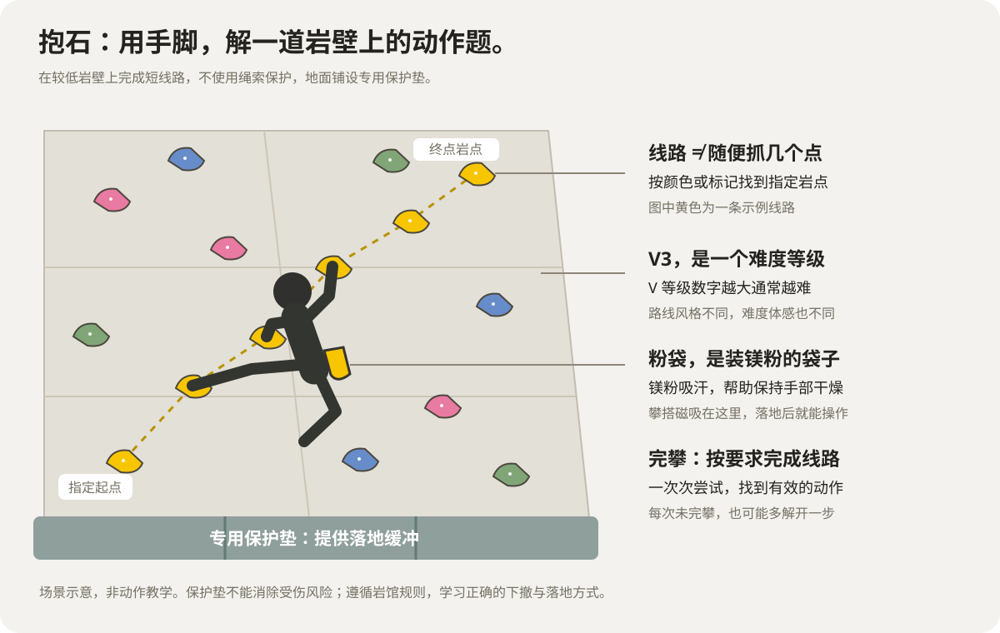

*黄色岩点标出一条示例线路：从起点开始，用手脚完成动作，到达终点。*

**岩点与线路：**墙上的抓点、踩点叫岩点，一组指定岩点组成线路。“黄色 V3”用颜色识别线路，用 V 等级表示难度，数字越大通常越难。

**尝试与完攀：**一次上墙挑战是一次尝试，按要求完成整条线路叫完攀。“换脚”是调整踩点的脚，“仰角”是岩壁向外倾斜；失败后调整再试，是正常训练过程。

**粉袋与搭子：**粉袋装着吸汗用的镁粉，是设备的佩戴入口；搭子是一起练习、交流和鼓励的伙伴。**攀搭把一个能记录、能交流的小搭子，放到粉袋旁边。**

<!-- page -->

## 02 / 为什么需要它：让努力被记住，让陪伴在现场

**攀岩最有价值的信息，往往发生在最不方便操作手机的时刻。** 刚落地时，你最清楚哪里卡住、哪次换脚有效、自己有多累；等到收工补记，鲜活的过程很容易只剩一句“今天还是没爬上去”。

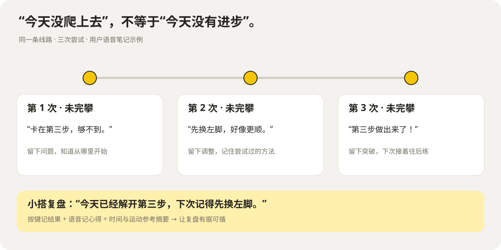

*示例中的动作变化来自语音心得。记录保留的不只是结果，还有下一次用得上的办法。*

### 2.1 每一次没拿下，都应该留下点什么
第一次卡住，第二次找到换脚办法，第三次多完成一步。记录保留有效经验，也让鼓励有依据：**“第 8 次，终于拿下了”背后，是前 7 次努力都被记住。** 不甘心继续时，休息与状态提醒又把注意力带回身体——今天的突破，和以后还能来爬，同样重要。

### 2.2 已有工具有价值，现场体验仍有关键缺口
攀岩 App 已有训练计划、记录和进度分析能力。例如 Crimpd 还支持训练中记录与计时。攀搭的差异化在于，**把记录入口、身体线索与情绪回应同时带到粉袋旁边。**

| 现有方式 | 在这个场景中的缺口 | 攀搭如何接上 |
|---|---|---|
| 手机 / 攀岩 App | 手掌、指尖沾满镁粉，触屏容易留下粉印；还需取用手机、切换记录入口 | 固定位置短按记录，语音留心得，IMU 提供运动线索 |
| 通用 AI 对话 | 没有接入训练档案时，需要用户重新描述线路和经历 | 当前线路、尝试、心得与声音情绪共同进入回答 |
| 岩友陪同 | 陪伴时间与对历史细节的记忆因人而异 | 随身记录持续积累，现场简短回应，手机端深入复盘 |

**攀搭的独特组合：低操作成本的记录入口 × 有训练记忆的情绪陪伴 × 身体状态提醒 × 可执行的下一次建议。** 对手上有粉、反复挑战、想持续进步的攀岩者，这是一套从现场出发的完整答案。

<!-- page -->

## 03 / 为什么用硬件：把“记一下”变得更容易

攀岩前从粉袋抓一把镁粉，手掌和指尖会留下白色粉末。刚落地就去拿手机，粉末容易沾上屏幕和机身；先擦手、再解锁、再点选，一次不难，每次尝试都重复就成了负担。

*左：[Derick Anies / CC0](https://commons.wikimedia.org/wiki/File:Chalk_bag_%28Unsplash%29.jpg)；中：[Abbottportraits / CC BY-SA 3.0](https://commons.wikimedia.org/wiki/File:Chalked_Hands.jpg)。照片等比排版；手机场景为原创三维渲染，组合图版以 [CC BY-SA 3.0](https://creativecommons.org/licenses/by-sa/3.0/) 提供。*

### 3.1 不是偶尔不方便，而是每次落地都要面对
手机可能放在场边，也可能正在拍摄。取手机、打开入口、确认线路、填结果，会把注意力从刚才的动作切到屏幕。推迟到训练结束再补记，往往就忘了具体次数和有效调整。

### 3.2 让记录融入习惯，不必先照顾屏幕
粉袋就在熟悉的位置。线路预先登记后，短按记录结果、振动确认；心得用按住说话保存。实体按键减少对触屏和持续注视的依赖，手机留给复盘、整理与深入交流。

**手上有粉，也能先把这次努力记住。**

<!-- page -->

### 3.3 让动作、声音和反馈配合起来

**攀搭围绕粉袋佩戴设计整套现场交互：结果记录、纠错、线路状态、对话时机与多通道提醒相互配合。** 磁吸固定、按键分工和反馈节奏共同服务一场连续训练。

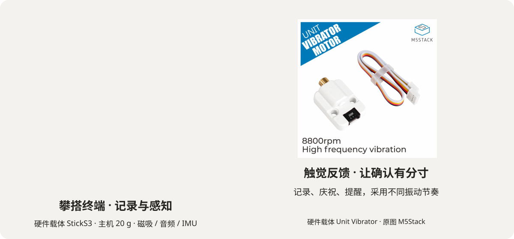

*硬件载体：[StickS3](https://docs.m5stack.com/en/core/StickS3) 与 [Unit Vibrator](https://docs.m5stack.com/en/unit/vibrator)。原图及参数来自 M5Stack，版权归其所有，等比组合展示；主机 20 g，不含外接模块。*

| 用户动作 | 设备响应 | 对应价值 |
|---|---|---|
| 正面短按 / 侧面短按 | 记未完攀 / 完攀，短震与屏幕确认 | 高频结果明确、快速，不必持续盯屏 |
| 正面长按说话 | 登记线路、记心得、向小搭提问 | 复杂信息交给语音理解 |
| 3 秒内改按 | 保留最终结果 | 容错；更早的误记回到 App 修正 |

### 3.4 设备知道结果，也留下身体与声音线索
主机通过磁吸固定在粉袋上。**按键**给出明确结果，**麦克风**留下内容与语气，**六轴动作传感器（IMU）**感知活动、失重和冲击。小屏、扬声器与振动分别承担看见、听见和感受到的反馈。

这枚 48 × 24 × 15 mm 的主机使用 ESP32-S3 芯片，连接 Wi-Fi 后与服务端通信。按键记录断网先缓存、恢复后补传；云端对话需要网络。外接振动模块采用匹配负载的受控供电。

**线路预先登记后：落地 → 按一下 → 收到确认 → 继续休息。**

<!-- page -->

## 04 / 说一句就留下，让小搭接得上你的训练

一次训练里，用户需要的既有准确记录，也有现场交流。攀搭把“说出信息—理解用途—关联线路—保存与回应”接成一条连续体验。

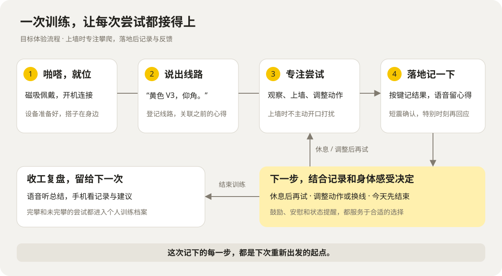

*从登记到复盘，语音负责表达丰富的信息，按键负责确认每次结果。*

### 4.1 “黄色 V3，往外倾斜的那条。”——语音登记
按住设备说话，松手结束。Step 识别颜色、难度与补充描述，建立当前线路；屏幕确认后，后续按键记录都归入这条线，省去反复选择。

### 4.2 “第三步先换左脚，帮我记一下。”——语音保存心得
模型整理口语表达，将笔记与线路、日期关联，保存到训练档案。App 中能查看和整理，再次挑战时可调出。**一句现场经验，成为下一次找得到的爬法。**

### 4.3 “这条总掉怎么办？”——带着记录对话
小搭结合当前线路、尝试和历史心得，先给简短建议；信息不够就继续询问。用户可追问、补充身体感受，或说“再说一遍”。收工说“今天就到这”，设备播报摘要，App 保存完整复盘与下次建议。

**会记录，也能交流：从记下一次尝试，到理解这一场训练。**

<!-- page -->

## 05 / 听出你的状态，也选对回应的语气

**情绪识别决定如何理解你，语气选择决定怎样回应你。** 两者共同服务一个具体时刻：刚刚落地、还在回想这次尝试的用户。

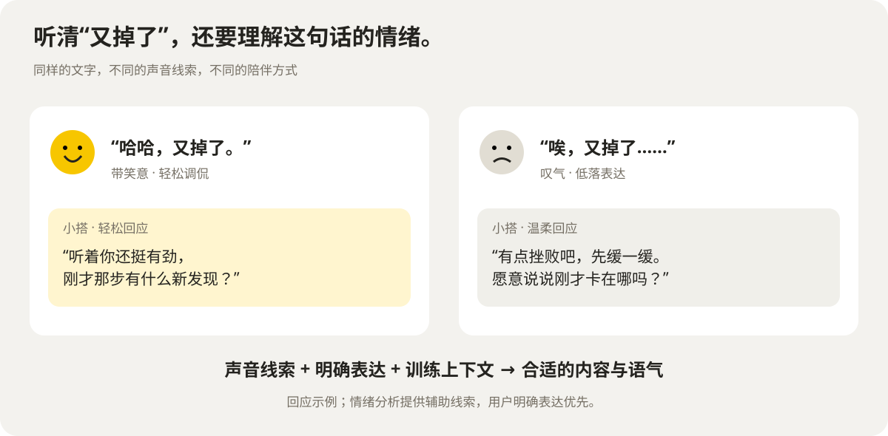

*同一句“又掉了”，声音里的笑意、叹气和语速提供额外线索，回应也随之变化。*

### 5.1 听懂“怎么说”，不只听懂“说了什么”
同一段录音同时交给 Step 做文字识别与声音情绪分析。语调、停顿、喘息、笑声补充文字信息；大模型结合用户表达和训练记录，判断此刻适合安慰、庆祝、询问还是建议休息。用户明确表达优先。

### 5.2 先选回应，再让声音表达出来
大模型组织回答并给出语气提示，情感语音合成据此控制表达：安慰时轻柔、庆祝时有活力、提醒时平稳。**内容和声音一起贴合情境，避免每种状态都收到同一句“加油”。**

### 5.3 你选相处方式，小搭把握现场分寸
App 可选活泼鼓励、冷静教练或带幽默的损友风格，与音色独立组合。普通按键只做短反馈，苦战完攀等特别时刻再说话；主动语音设间隔，在落地后触发。疲惫或疼痛时优先关心状态，而非继续催促。

<!-- page -->

## 06 / 打开 App，刚才的努力都有了去处

设备负责爬的时候轻松记下，手机负责爬完后慢慢看懂。App 是训练管理与交流入口：整理线路、修正误记、回看成长、继续问小搭。它以手机网页提供，可添加到主屏幕使用。

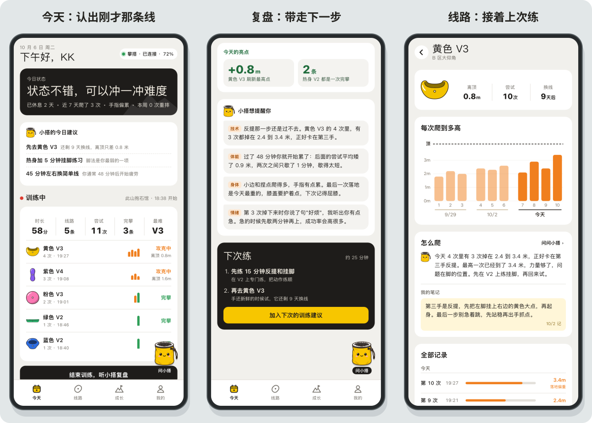

*App 界面与数据展示样例。今天、复盘、线路详情，共同围绕一场真实训练组织信息。*

### 6.1 今天｜刚才每一次，都在这里
设备结果按线路归组，汇总时长、尝试、完攀与最高难度。**先给结论，再给明细**，颜色与难度帮助用户认出熟悉的线路，不必重新数一遍。

### 6.2 复盘｜带着一个方向离开岩馆
尝试、休息与提醒按时间排在一起，小搭解释亮点和需要留意的变化。**“加入下次建议”紧跟训练任务**：比如今天发现换脚是重点，下次打开首页就能接着练。

### 6.3 线路｜上次试出的办法，下次还找得到
不同日期的尝试和语音心得归在同一条线下。手机修正较早的误按后，统计和小搭后续参考的记录一起更新。**粉袋旁随口说的一句话，成为下次找得到的爬法。**

<!-- page -->

## 07 / 你的搭子，你来决定怎样相处

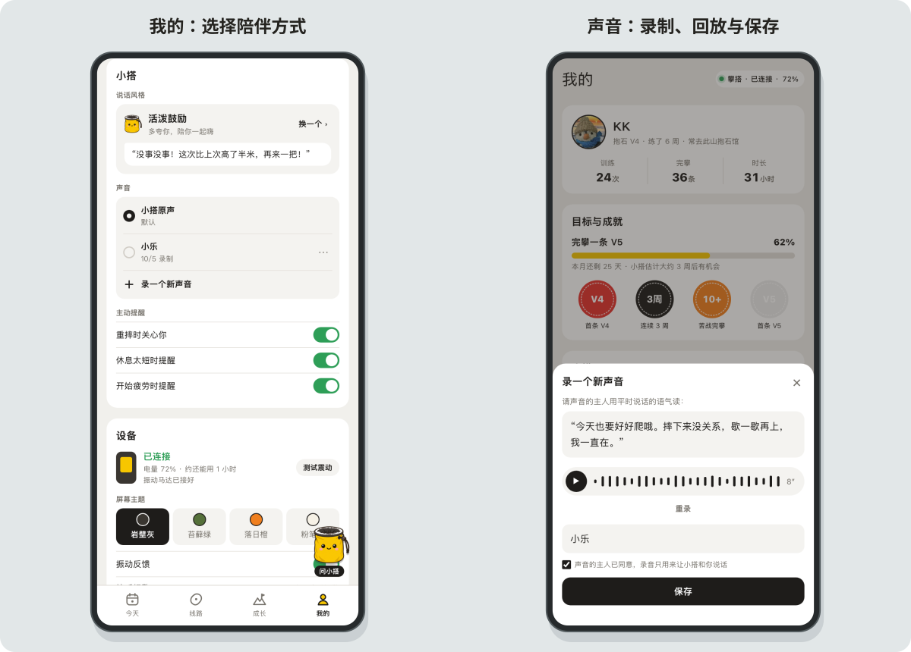

*成长、我的与声音录制界面展示。能力维度用于训练参考，解释与数据来源随结论展开。*

### 7.1 声音定制｜录下来，让熟悉的声音陪你
打开“录一个新声音”，请声音主人读一段话，录制约 5–10 秒，回放确认、起名并确认授权后保存。音色服务建立声音配置，加入个人声音库。**原声和定制声音可切换、试听、改名与删除，选择同步用于设备播报。**

### 7.2 语气风格｜同一种声音，也可以有不同性格
风格卡先展示一句回应，帮助选择热情、简洁或幽默的交流方式。音色决定“听起来像谁”，风格决定“平时怎样说”，情境语气决定“这一句怎样表达”；三者共同传给模型和语音合成服务。

### 7.3 主动提醒｜让陪伴有合适的分寸
重摔关心、休息提醒和疲劳提醒提供独立偏好设置；App 同时展示连接、电量、屏幕主题和振动配置。手机里的选择通过服务端作用于设备，小搭按熟悉的方式与你交流。

### 7.4 视觉｜每种颜色都有职责
“岩馆白墙”底色降低干扰，**小搭黄标识 AI 与提问入口**；岩点颜色标识线路，绿、橙、红搭配文字解释状态。数据格统一为“名称—数字—比较”，选中采用黑底白字。视觉帮助分清信息、状态和下一步操作。

**换了终端，训练记忆和陪伴偏好仍然连续。**

<!-- page -->

## 08 / 点开右下角小搭：看到哪里，就从哪里聊起

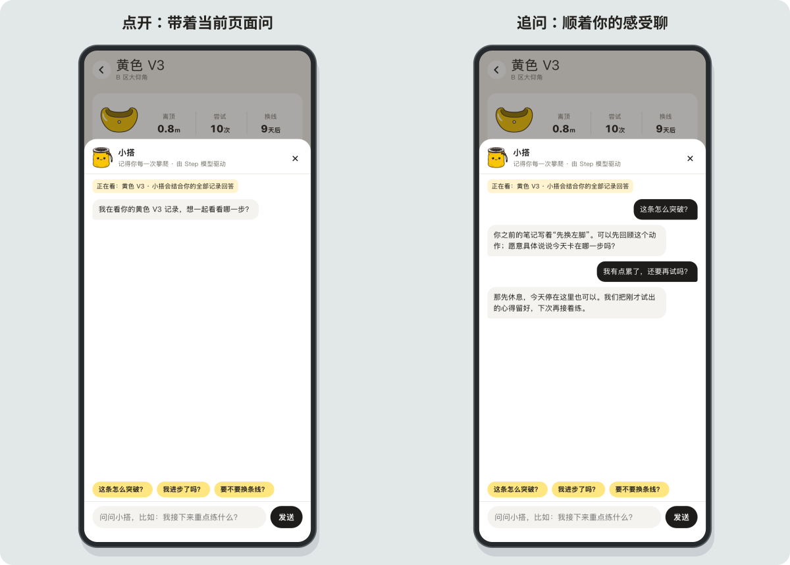

*小搭展开与连续追问界面；对话为展示样例。*

### 8.1 不用重新介绍一遍
点开右下角小搭，面板从底部展开，保留原页面背景。顶部显示“正在看：黄色 V3”，告诉你它正在参考什么；“怎么突破”“有进步吗”等快捷问题帮助开口。**不用再次介绍线路，也不用重新讲一遍训练经历。**

### 8.2 回答接得上过去，也听你现在
“你之前的笔记写着先换左脚。”设备旁说过的心得，成为手机追问的依据。下一句说“我累了”，小搭也可以转向休息建议。信息不足时继续询问，交流围绕用户的具体经历展开。

### 8.3 聊完，回到刚才的地方
输入框支持连续追问，关闭面板后继续看线路。设备端适合听一句简短回应，手机端适合把问题聊深。**同一个小搭，共用同一份档案；陪伴延续到训练之外。**

<!-- page -->

## 09 / 身体状态分析：让局部感受和训练记录对上

“今天爬得多”只是总量；用户更关心“手指为什么一直累”“肩膀需不需要休息”。成长页用可点击的人体图，把身体感受、训练负荷和提醒事件放到一起。

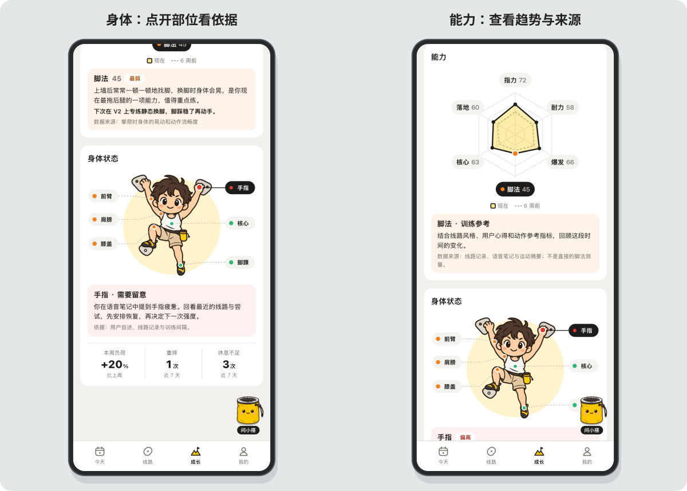

*身体区域与能力维度界面示例。点击部位可查看相关记录、用户自述和训练建议。*

### 9.1 点一下部位，知道为什么要留意
手指、前臂、肩膀、核心、膝盖、脚踝分别展示关注状态，配合颜色与文字。点开后说明关联的训练记录、表达过的不适或异常落地事件，再给出休息、调整或停止训练的建议。

### 9.2 多种信息结合，让分析有来由
设备提供次数、间隔和冲击等摘要，线路描述与语音笔记补充动作类型，用户自述补充疼痛和疲劳。程序汇总负荷与事件，Step 解释变化；没有足够依据时先询问，不把一次晃动直接等同于某个部位疲劳。

### 9.3 和自己比较，而不是只看一个分数
能力雷达、难度分布、完攀率与尝试效率帮助观察趋势，维度解释同时交代数据来源。人体图是**训练状态的解释入口，不是医学检测结果**；设备不能直接测量局部肌肉疲劳或诊断损伤。

<!-- page -->

## 10 / 安全提醒：有人为突破高兴，也有人支持停下

“就差一点，再试一次。”兴奋和不甘心让人不愿结束，也容易忽略身体状态。对热爱运动的人，严重受伤打断的不只是训练，还有释放压力、与朋友相聚的日常；部分损伤会让重返运动更困难。

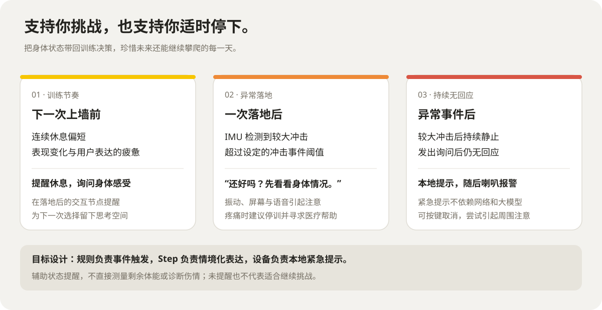

*从下一次上墙前到异常落地后，提醒围绕可观察的事件触发。*

### 10.1 连续没歇够，先提醒缓一缓
多次尝试间隔过短，结合表现变化和用户说出的疲惫，小搭在落地后提醒检查状态，建议休息或结束训练。它既回应不甘心，也给出暂停的具体理由。

### 10.2 落地异常，先问一句“还好吗？”
IMU 检测较大冲击后，振动、屏幕和语音引起注意；较大冲击后持续静止、询问后仍无回应，再启动本地提示音与报警。按键优先取消提醒，避免误记成一次尝试。表达疼痛时建议停训并寻求医疗帮助。

### 10.3 规则及时触发，模型把话说得合适
事件判断与紧急提示由本地规则处理，Step 根据记录组织关心与提醒话术。**安全功能提供辅助提醒；未触发不代表安全，设备不直接测量剩余体能或诊断伤情。**

<!-- page -->

## 11 / 技术方案：设备、App 和 AI 为什么接得上

前面的体验依靠三部分协作：**设备负责听、记和感知；服务端保存档案并调度；Step 模型负责理解与表达。** App 通过服务端读写同一份记录，让两端的小搭记得同一段经历。

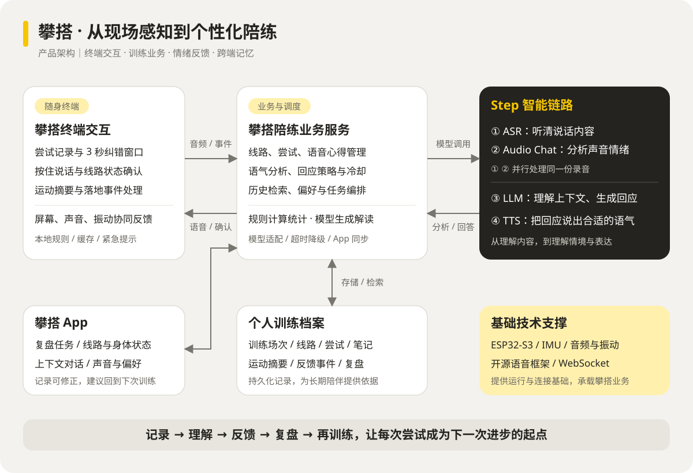

*完整产品架构：端侧感知与反馈，服务端组织数据，Step 理解与表达，App 管理与行动。*

### 11.1 攀搭自己的业务模型，组织一场训练
终端交互定义按键纠错、线路状态和多通道反馈；陪练服务按“用户—训练场次—线路—尝试”关联心得、身体线索与提醒。设备与服务端复用小智开源音频和连接基础，攀搭业务与 App 共用训练档案。

### 11.2 情绪与反馈编排，让模型适合运动现场
语音内容与声音情绪并行分析，汇合训练上下文后生成回应，再用语气提示控制 TTS。事件触发、主动反馈间隔、超时降级与偏好配置一起决定何时开口、说什么、怎么说。

### 11.3 一条建议，回到真实训练
设备记“第三步先换脚” → App 线路笔记 → Step 整理复盘 → 加入下次任务 → 再次挑战时调用。**这条回流路径，是软硬模一体化的核心。**

IMU 提取运动摘要而非上传全部原始流；下落距离由失重片段估算，不等同于手部到达高度或精确岩点位置。运动线索与用户笔记共同服务训练分析。

<!-- page -->

## 12 / Step：听清一句话，理解一段训练

**语音识别、声音情绪分析、语言推理、情感语音合成，四个核心模型环节均采用 Step。** 每种能力都承担明确任务，并在设备交流与 App 解读中复用。

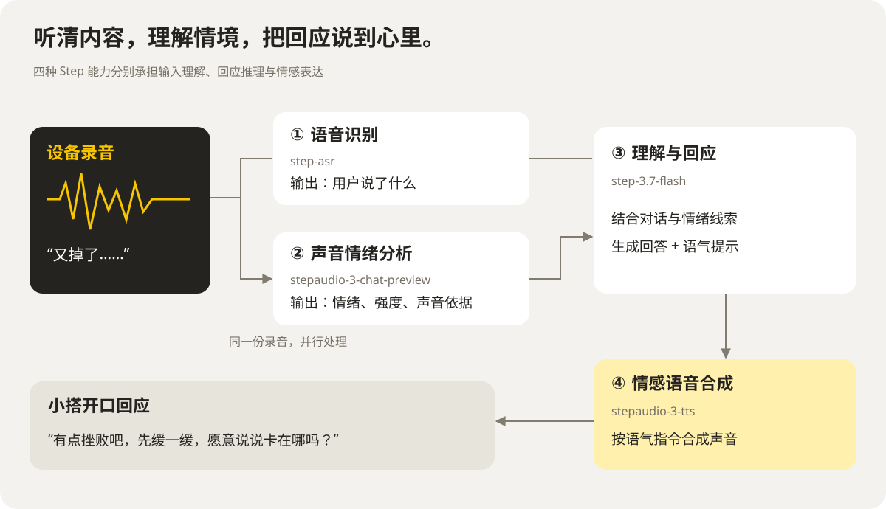

*同一份录音并行识别内容与声音情绪，回答及语气提示交给 TTS 输出。*

### 12.1 四种模型能力，各自承担明确任务

| 模型 | 在攀搭中的职责 |
|---|---|
| `step-asr` | 听清线路、心得和提问，提供文字输入 |
| `stepaudio-3-chat-preview` | 分析语调、语速、停顿等声音情绪线索 |
| `step-3.7-flash` | 结合相关档案对话、复盘、回答 App 追问，生成建议与语气提示 |
| `stepaudio-3-tts` | 根据人设与语气指令，表达鼓励、安慰和提醒 |

### 12.2 从理解情绪到表达回应

**“又掉了”可以带着笑意，也可以带着沮丧。** 声音线索补充文字，训练记录补充经历，Step 再选择回答内容与表达方式。用户明确表达优先；情绪分析超时则退回文字链路，缺少语气提示时使用默认映射。

模型使用深度体现为**核心链路覆盖与跨场景复用**；统计、本地记录和紧急报警交给确定性程序处理。

<!-- page -->

## 13 / 产品价值：把 AI 带进真正需要它的时刻

### 13.1 三个核心创新
**面向攀岩重新设计交互。** 粉袋佩戴、按键记录与纠错、线路确认、落地后反馈共同组成低打扰的使用流程。

**将模型能力编排成陪练能力。** 并行理解内容与语气，结合训练档案选择回应，再控制情感声音；让鼓励有来由、建议有上下文。

**反馈回到行动。** 设备记录进入 App，App 偏好影响设备，Step 复盘变成下次任务；既支持挑战，也支持适时休息。

### 13.2 六个维度，理解产品价值

| 价值维度 | 产品中的具体体现 |
|---|---|
| 完成度 | 语音登记与保存、情绪对话、声音定制、身体状态与安全提醒贯穿记录—复盘—再训练 |
| 实用性 | 对应手上沾粉、记录易漏、心得易忘与疲劳时难停下的真实问题 |
| 用户体验 | 按键轻记录、对话带上下文；音色、风格和情境语气独立组合，人体图解释状态 |
| 技术创新 | 事件、身体线索与声音情绪结合；并行分析、上下文检索与情感表达协作 |
| **软硬模一体化** | 同一份训练档案驱动设备和 App，建议与偏好形成双向回流 |
| **Step 模型使用率** | 四个核心模型环节均使用 Step，覆盖现场交流与训练解读 |

训练档案持续积累，连接训练计划、目标追踪与周度复盘，形成长期陪伴。

> **攀搭，啪嗒一下，搭子就位。**
> 让今天的尝试，成为下次进步的起点。也珍惜未来还能继续攀爬的每一天。
